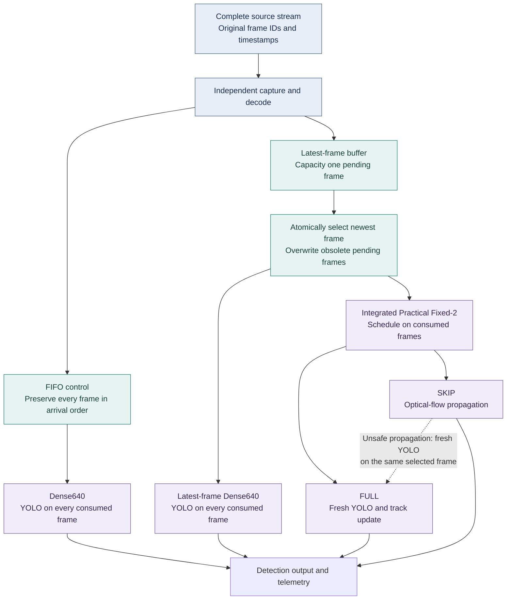
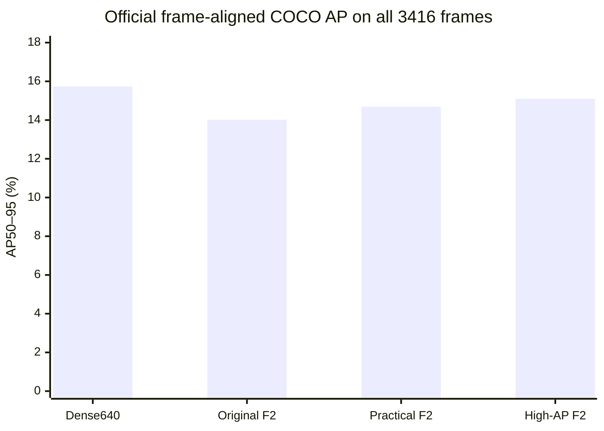

<div align="center">

# Adaptive Vision

### Efficient YOLO video detection through selective inference and latest-frame buffering

**Branch B · Completed research prototype · Argoverse-HD · CPU FP32**

[Results](#results-at-a-glance) · [Architecture](#two-mechanisms-one-integrated-pipeline) · [Evaluation](#streaming-validation) · [Evidence](#research-and-evidence-guide) · [Future scope](#future-scope)

<br>

| **3,416** annotated frames | **5** complete sequences | **6** completed approaches | **175** valid streaming runs |
|:---:|:---:|:---:|:---:|
| Provided ground truth | Local development scenes | Plus FIFO control | Of 180 planned conditions |

</div>

---

## Research in one sentence

**Reduce repeated detector work, avoid processing obsolete frames, and measure the accuracy cost of both decisions.**

This repository contains **Branch B** of *Practical YOLO-Based Object Detection Under Challenging Visual Conditions: Low-Light Failure Analysis and Adaptive Real-Time Video Processing*. It evaluates a frozen, stock COCO-pretrained YOLOv8n on driving-video sequences. The separate low-light/ExDark branch is outside this repository's research scope.

The investigation distinguishes two contributions:

- **Fixed-2 selective inference** reduces detector calls by propagating tracks with optical flow between scheduled detections.
- **Latest-frame adaptive buffering**, our original adaptive-framing mechanism, replaces obsolete waiting frames while capture continues independently.

Their integration increases frame coverage under overload, but its benefits depend on arrival rate and scene. **Higher output frequency does not establish higher detection accuracy.**

## Results at a glance

| Finding | Verified result | Scope |
|:---|:---|:---|
| **Offline efficiency** | Practical Fixed-2: **49.35% higher throughput**, **36.50% less CPU time/frame**, **49.94% fewer detector calls** | Versus Dense640, all 3,416 frames; matched CPU campaign |
| **Accuracy cost** | Practical Fixed-2: **−1.040467 AP percentage points** | Official frame-aligned COCO AP50–95 versus Dense640 |
| **Freshness under overload** | Latest-frame Dense640: **99.18% lower P95 latency** | Mean paired reduction versus FIFO at 90 FPS; **10 valid matched pairs across four sequences** |
| **Conditional integration benefit** | At 60 FPS: **25.26% less CPU time**, **26.71% lower P95 latency** | Integrated versus latest-frame Dense640; 15 valid matched pairs |
| **Negative finding** | At 60 FPS: **−0.128 AP percentage points** on average; no consistent time-aligned AP gain | Mean within-sequence/trial effect, distinct from pooled AP |

> **Final operating recommendation:** retain **latest-frame + Dense640** as the streaming reference. Use **latest-frame + Practical Fixed-2** as an optional efficiency mode. Practical Fixed-2 remains the offline efficiency reference; High-AP Fixed-2 is a separate accuracy-oriented configuration.

## Two mechanisms, one integrated pipeline



**Ordering is part of the method.** Integration selects the newest packet **before** advancing Fixed-2. Overwritten source frames do not advance the detector schedule. Original source gaps remain available to motion estimation and confidence aging; unsafe state or propagation triggers fresh inference. There is no second pending FIFO queue.

`SKIP` means **skip YOLO inference** while still processing the image and updating temporal predictions. A buffer overwrite means an unconsumed source frame is replaced. These are different events. An inference already in progress is not cancelled when a newer frame arrives.

### The six completed approaches

| # | Approach | Processing policy | Role |
|:--:|:---|:---|:---|
| 1 | **Dense640** | YOLO on every source frame | Offline accuracy and cost reference |
| 2 | **Original Fixed-2** | Alternate FULL and optical-flow SKIP | Initial selective-inference reference |
| 3 | **Practical Fixed-2** | Observation anchoring, low-score existing-track recovery, 3 × 3 flow grid, fixed-schedule fast path | Offline efficiency reference |
| 4 | **High-AP Fixed-2** | Anchoring and recovery, 4 × 4 grid, weak track births at confidence 0.10, fast path | Accuracy-oriented temporal variant |
| 5 | **Latest-frame + Dense640** | Capacity-one newest-frame selection, then dense inference | Original adaptive-framing contribution; streaming reference |
| 6 | **Latest-frame + Practical Fixed-2** | Newest-frame selection, then consumed-step Fixed-2 with safety fallbacks | Optional integrated efficiency mode |
| Control | **FIFO + Dense640** | Preserve and process all arriving frames in order | Streaming backlog and latency control |

Rejected adaptive schedulers, Fixed-3 and historical ablations are retained as development history. They are **not** part of the final expanded validation matrix.

## Offline validation

All four configurations use the **same complete 3,416-frame population** and provided annotations. Verified matching archived results were reused; expanded validation did not require redundant offline inference.

| Configuration | COCO AP50–95 % | AP50 % | AP75 % | Decode-inclusive FPS | CPU ms/frame | YOLO calls |
|:---|---:|---:|---:|---:|---:|---:|
| **Dense640** | **15.732713** | **23.865010** | **15.654390** | 41.581 | 53.0524 | 3,416 |
| Original Fixed-2 | 14.020016 | 20.814922 | 13.997525 | 50.952 | 37.3313† | 1,710 |
| **Practical Fixed-2** | 14.692246 | 21.897441 | 14.787367 | **62.101** | **33.6867** | **1,710** |
| **High-AP Fixed-2** | 15.091065 | 22.715169 | 15.117125 | 60.981 | 34.3416 | 1,710 |

Dense, Practical and High-AP timing results use five matched real-inference passes. **† Original Fixed-2 has an earlier single timing pass and broader whole-evaluation CPU accounting; its CPU value is not directly comparable to the matched campaign.** Offline FPS measures file-processing throughput, not live-camera latency.

<details>
<summary><strong>Operating-point accuracy and object-size results</strong></summary>

Precision, recall and F1 below are micro values at confidence ≥ 0.25 and IoU 0.50. They are separate from COCO AP and average recall.

| Configuration | Precision % | Recall % | F1 % | AP small % | AP medium % | AP large % |
|:---|---:|---:|---:|---:|---:|---:|
| Dense640 | 76.80 | 28.31 | 41.37 | 1.009 | 15.400 | 53.458 |
| Original Fixed-2 | 77.80 | 27.65 | 40.80 | 0.726 | 12.577 | 47.894 |
| Practical Fixed-2 | 77.81 | 27.67 | 40.83 | 0.781 | 13.594 | 51.399 |
| High-AP Fixed-2 | 77.76 | 27.66 | 40.80 | 0.812 | 14.468 | 51.924 |

Small objects remain a major detector limitation. Higher fixed-confidence precision does not establish higher AP across thresholds and IoUs.

</details>

### Reading the offline trade-off



The visual shows how later Fixed-2 configurations recover some accuracy relative to Original Fixed-2 while all remain below Dense640. Practical gains **0.672230 AP points** over Original Fixed-2; High-AP gains another **0.398819 points** over Practical. These are configuration comparisons involving multiple settings, not isolated causal ablations.

High-AP retains approximately **95.92% of Dense640 AP**, but is slightly slower than Practical. At confidence 0.10, High-AP produces **20,680** false-positive events versus Practical's **15,239**; at confidence 0.25 the counts are **4,383** versus **4,373**. High-AP's accuracy and Practical's efficiency or false-positive counts must never be combined into a fictitious single configuration.

## Streaming validation

### Complete sequences, controlled arrivals, repeated trials

**5 sequences × 4 replay rates × 3 arms × 3 intended trials = 180 conditions.**

Each arm is offered the same complete ordered source stream and timestamp schedule at **15, 30, 60 and 90 FPS**. Each new pass resets model and temporal state, uses three excluded warmups, and records capture, selection and result-completion times. Two earlier complete 15 FPS runs were independently verified and reused.

| Replay FPS | FIFO complete / valid | Latest Dense complete / valid | Integrated complete / valid | Incomplete |
|---:|:---:|:---:|:---:|---:|
| 15 | 15 / 15 | 15 / 15 | 15 / 15 | 0 |
| 30 | 15 / 15 | 15 / 15 | 15 / 15 | 0 |
| 60 | 15 / 15 | 15 / 15 | 15 / 15 | 0 |
| 90 | 12 / 10 | 15 / 15 | 15 / 15 | 3 |
| **Total** | **57 / 55** | **60 / 60** | **60 / 60** | **3** |

**177 runs completed; 175 are pacing-valid.** Three FIFO 90 FPS attempts stopped at the memory guard: `sequence_00` trials 2/3 and `sequence_01` trial 2. The other two `sequence_01` FIFO trials completed but failed pacing validity. Invalid and incomplete runs are excluded from primary comparisons; missing AP is never replaced with zero.

Resource safeguards preserve FIFO semantics: a **4,096 MiB process RSS guard**, **180 s worker-loop deadline** and **240 s supervisor deadline** stop unsafe runs rather than introducing frame dropping. Discrete RSS checks can slightly overshoot the threshold. No fully valid five-sequence FIFO cohort exists at 90 FPS.

### Delivered-output accuracy

The following values are **custom replay-time-aligned held-output AP**, not conventional frame-aligned COCO AP and not an official streaming benchmark. At every source-time query, the latest result already completed is scored against the query frame; an unavailable output is empty. Results completing after the last query do not improve this score.

Each entry averages three pacing-valid cohort scores, each jointly evaluating all **3,416 source queries** over independently reset sequences.

| Replay FPS | FIFO Dense AP % | Latest Dense AP % | Integrated AP % |
|---:|---:|---:|---:|
| 15 | 13.4638 | 13.4617 | 12.5830 |
| 30 | 12.7867 | 12.8498 | 11.2724 |
| 60 | 6.6323 | 10.7368 | 10.4522 |
| 90 | **N/A — no valid full cohort** | 9.9893 | 9.2890 |

Buffering preserves more useful outputs under overload than FIFO's growing backlog. However, integration does **not** consistently improve delivered-output AP over latest-frame Dense640.

### Integration versus latest-frame Dense640

These are arithmetic means of **within-sequence/trial paired effects**, with 15 valid pairs at each rate. Positive reductions indicate savings; negative reductions indicate increases. AP changes are percentage points and are **not differences between the pooled AP values above**.

| Replay FPS | CPU time reduction % | YOLO call reduction % | P95 latency reduction % | Time-aligned AP change (pp) |
|---:|---:|---:|---:|---:|
| 15 | 26.38 | 47.47 | **−15.67** | −0.983 |
| 30 | **35.90** | **47.49** | **−4.60** | −1.690 |
| 60 | 25.26 | 39.86 | **26.71** | −0.128 |
| 90 | 3.81 | 16.22 | 11.67 | −0.452 |

At **60 FPS**, mean frame coverage rises from **86.71% to 99.46%** and active output rate from **51.88 to 59.63 FPS**, while six of fifteen pairs still lose time-aligned AP. At **90 FPS**, coverage rises from **56.98% to 89.86%**, but twelve of fifteen pairs lose AP. At 15 and 30 FPS, all fifteen pairs at each rate lose time-aligned AP, and mean P95 latency increases.

For context, at **60 FPS** the mean per-run P95 latency is **1,646.73 ms for FIFO** versus **43.64 ms for latest-frame Dense**. Mean peak pending depth is **89.07 versus 1**, and process peak RSS is **1,364.26 versus 534.95 MiB**, over fifteen valid runs per arm. Capacity one bounds pending frames; it does not bound all process memory or guarantee a hard latency deadline.

The **99.18% P95 reduction at 90 FPS** uses ten valid FIFO/latest matched pairs: `sequence_00` trial 1 and all three trials of `sequence_02`–`sequence_04`. It is not a five-sequence 90 FPS estimate or a result for every replay rate.

### Negative findings retained

The original integrated pilot used only the first **300 frames of `sequence_00`**, with two trials per rate at 15/90 FPS. Its 90 FPS time-aligned AP advantage **did not persist on average** in expanded full-sequence validation.

The pilot also failed two predeclared acceptance criteria: its **4.8731%** CPU reduction missed the **5%** requirement, and its second 15 FPS trial's **46.57 ms** P95 exceeded the **43.28 ms** allowance. Those failures remain part of the evidence. Applying that historical latency allowance descriptively to expanded 15 FPS results gives failures in **11 of 15** pairs; this is not a newly predeclared acceptance test.

## Dataset and frozen protocol

| Sequence | Frames |
|:---|---:|
| `sequence_00` | 901 |
| `sequence_01` | 901 |
| `sequence_02` | 469 |
| `sequence_03` | 475 |
| `sequence_04` | 670 |
| **Total** | **3,416** |

The local Argoverse-HD export contains **1920 × 1200** images, **55,412 regular targets** and **2,299 crowd annotations**. Supported classes are **person, bicycle, car, motorcycle, bus, truck, traffic light and stop sign**. All five scenes participated in development; they are **not an unseen test set**.

| Component | Frozen setting |
|:---|:---|
| Detector | Stock COCO-pretrained YOLOv8n; unchanged weights; no training or fine-tuning |
| Inference | CPU FP32, batch 1, `imgsz=640`; recorded tensor `1 × 3 × 416 × 640` |
| Prediction generation | Confidence `0.001`, NMS IoU `0.7`, global `max_det=300` |
| Official offline evaluation | `pycocotools` COCO bbox AP; IoU 0.50:0.05:0.95; `maxDets=[1,10,100]` |
| Fixed-2 propagation | Sparse pyramidal Lucas–Kanade flow; confidence decay `0.93`; state reset per sequence |
| Practical recovery/admission | Existing-track recovery from `0.10`; new-track admission at `0.25` |
| Runtime controls for expanded replay | Torch intra/inter-op threads `8/1`; OpenCV threads `10`; OpenCL disabled |

The evaluator's per-category maximum of 100 is distinct from the detector's global cap of 300. Source IDs, timestamps, class mappings, box coordinates and crowd flags are preserved. Exact configuration dictionaries and hashes live in the local expanded-run evidence bundle.

<details>
<summary><strong>Metric definitions and comparison boundaries</strong></summary>

| Metric | What it measures | Interpretation boundary |
|:---|:---|:---|
| **Official offline COCO AP** | Predictions for their corresponding input frames | All 3,416 frames; four offline configurations |
| **Streaming frame-aligned AP** | Predictions on the intersection consumed by all complete arms in a sequence/rate/trial cell | Conditional population varies by cell; not full-stream AP |
| **Custom time-aligned AP** | Latest completed output available at each source-time query | Different temporal question; not official streaming AP |
| **Offline throughput** | Decode-inclusive frames processed per second in the declared timing scope | Not replay latency or live-camera FPS |
| **Active output FPS** | Results completed within the first-to-last source-arrival window | Excludes post-EOF completions |
| **Capture-to-result latency** | Scheduled source arrival to completed result, including decode, queue wait and processing | Excludes model startup, warmup, scoring and physical display |
| **CPU time** | Process execution accumulated across threads | May exceed wall time; not energy consumption |
| **Coverage / overwrites** | Consumed source frames / replaced unconsumed pending frames | Separate from inference SKIP decisions |
| **Peak RSS** | Process-lifetime high-water memory | Includes model and telemetry, not just pending images |

Pacing validity requires publication span within 3% of target, P95 decode-start lateness within one source period, and maximum lateness within two periods. Three repetitions expose variability but do not establish statistical significance or independent scene replication.

</details>

## Research and evidence guide

### Versioned implementation and development reports

| Start here | Purpose |
|:---|:---|
| [`pipeline.py`](extracted/adaptive_pipeline/pipeline.py) | Offline detector and temporal-processing orchestration |
| [`frame_manager.py`](extracted/adaptive_pipeline/adaptive_framing/frame_manager.py) · [`capture.py`](extracted/adaptive_pipeline/adaptive_framing/capture.py) | Queue policies, independent capture and timestamp replay |
| [`streaming_fixed2.py`](extracted/adaptive_pipeline/streaming_fixed2.py) | Consumed-frame scheduling, source-gap handling and safety fallbacks |
| [`worker.py`](analysis/branch_b_expanded_v1/worker.py) | Full-sequence frozen replay worker and resource guards |
| [`continue_local.py`](analysis/branch_b_expanded_v1/continue_local.py) | Expanded matrix, verified reuse and execution provenance |
| [`COCO phase 1`](docs/COCO_PHASE1_RESULTS.md) | Official rescoring and initial offline references |
| [`Phase 2`](docs/PHASE2_RESULTS.md) · [`Phase 3`](docs/PHASE3_RESULTS.md) | Anchoring, confidence handling and practical refinements |
| [`Experiment E`](docs/EXPERIMENT_E_RESULTS.md) | Matched real-inference offline timing |
| [`Latest-frame pilot`](docs/LATEST_FRAME_RESULTS.md) · [`Integration pilot`](docs/LATEST_FRAME_FIXED2_RESULTS.md) | Earlier **300-frame** streaming experiments, not expanded results |

Some older guides and reports describe historical populations or evaluator versions. The final protocol and populations summarized here take precedence when interpreting the completed Branch B investigation.

### Local evidence bundle

Large run artifacts, figures, datasets and manuscript exports are **Git-ignored**. The paths below describe the existing research workspace; they are not promised contents of a fresh clone. No dataset or model download is initiated by this README.

```text
runs/branch_b_expanded_local_v2/
├── configs/                         # Four frozen offline configurations
├── manifests/                       # Complete ordered source sequences
├── passes/                          # Per-attempt telemetry and completion records
├── analysis/
│   ├── execution_matrix.csv          # All 180 conditions and their status
│   ├── offline.csv                   # Four full-population offline summaries
│   ├── offline_per_sequence.csv      # Per-sequence detection metrics
│   ├── streaming.csv                 # Per-run timing, coverage and accuracy
│   ├── pooled_aligned.csv            # Cohort-level held-output AP
│   ├── paired_effects.json           # Valid within-sequence/trial effects
│   └── incomplete.csv                # Explicitly incomplete attempts
├── figures/                          # 19 verified comparison figures
├── frozen_sha256.json                # Frozen source/configuration provenance
└── FINAL_VERIFICATION.json           # Independent artifact/calculation audit
```

The **44-page research handoff** is available locally at `research_handoff/Branch_B_Research_Handoff.pdf`. An expanded Markdown handoff and evidence index are retained under `runs/branch_b_expanded_local_v2/analysis/presentation_revision_1/`.

The figure collection covers offline accuracy and cost, object sizes, per-sequence AP, latency, output rate, coverage, CPU, RSS, queue growth, detector fallbacks, execution status and both accuracy definitions. Representative files include `03_offline_tradeoffs.png`, `05_latency.png`, `08_resources.png`, `15_queue_growth.png` and `17_pooled_aligned.png` under `figures/`. The diagrams and chart in this README render from Markdown without relying on those local images.

### Working with the completed project

The active package is `extracted/adaptive_pipeline/`; expanded evaluation support is `analysis/branch_b_expanded_v1/`. Root `main.py` is a legacy entry point. The older `run_stream.py` pilot is intentionally bounded to 300 frames; the expanded worker is the full-sequence entry point.

For a separately authorized reproduction, use an isolated Python environment with `requirements.txt` and `requirements-evaluation.txt`, the existing local checkpoint and dataset, the archived resolved configurations, and a fresh output directory. **The archived continuation runner targets its historical run directory; it is not a generic fresh-run command.** Manifests and configuration model paths must resolve to the same local files before execution. Preserve historical outputs and classify pacing failures and safety stops explicitly.

No automatic execution, downloads, training or retuning are required to inspect the reported results.

## Limitations

- **Development-set validation:** all five sequences were used during method development. Full-sequence replay strengthens coverage over the original prefix but establishes no unseen-scene generalization.
- **Correlated observations:** adjacent frames and repeated trials do not create independent scenes. Results are descriptive; no statistical-significance claim is made.
- **Replay environment:** warm file caches, process scheduling, thread settings and run order affect timing. Real-camera capture, sensor-to-display latency, energy and long-duration deployment were not measured.
- **Incomplete FIFO cohort:** 90 FPS memory stops and pacing failures limit valid comparisons. Invalid and incomplete runs cannot support full-cohort claims.
- **Detection and propagation limits:** small-object AP remains low. Source-gap guards do not prove arbitrary-gap tracking robustness, and capacity one does not guarantee a latency deadline.
- **Annotation provenance:** preservation checks verify consistency with the provided export, not an independent annotation-quality audit.

## Future scope

The completed algorithms remain frozen. Future work should strengthen validation before pursuing another optimization cycle.

| Priority | Next investigation | Evidence it would add |
|:---:|:---|:---|
| **1** | Independently selected, unseen annotated driving sequences | External validity beyond the five development scenes |
| **2** | Longer repeated sessions with balanced order and reported uncertainty | Runtime stability and sensitivity to scheduling or thermal effects |
| **3** | Real-camera tests with preserved capture clocks | Physical acquisition and display latency, buffering outside the application |
| **4** | Cross-hardware and energy measurements under matched settings | Portability, deployment cost and power-efficiency evidence |
| **5** | Prespecified analysis of motion, object size, occlusion and source gaps | Conditions where propagation and newest-frame selection help or fail |

These are proposed studies, not completed results. Additional data access, experiments and any algorithm changes require a separate research phase.

---

<div align="center">

**Completed within the stated local evaluation scope.**

Selective inference saves detector work. Latest-frame buffering reduces obsolete work.<br>
Their integration offers conditional efficiency gains with measurable accuracy trade-offs.

</div>
